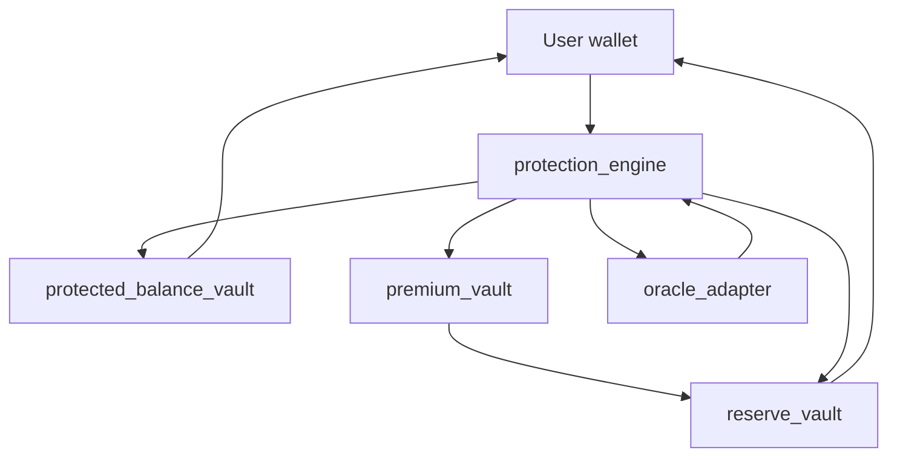

# CoverFi Soroban contracts

CoverFi contracts power stablecoin loss protection on Stellar/Soroban. This repository is the open-source smart contract workspace for CoverFi.

Repository URL:

```txt
https://github.com/CoverFI-space/coverfi-contracts
```

## Contract overview

CoverFi lets a user create a protection position for a stablecoin or Stellar asset. The position records protected amount, trigger price, expiry, fee, payout cap, and claim state. If the oracle price drops below the selected trigger before expiry, the position can be triggered and the user can claim a reserve-backed payout.

The workspace contains five contracts:

| Contract | Purpose | Source |
| --- | --- | --- |
| `protection_engine` | Main user-facing contract. Creates positions, calculates fees, checks oracle prices, triggers claims, expires positions, and coordinates withdrawals. | [`protection_engine/src/lib.rs`](https://github.com/CoverFI-space/coverfi-contracts/blob/main/protection_engine/src/lib.rs) |
| `protected_balance_vault` | Holds protected principal by position ID. Only the configured protection engine can deposit and withdraw. | [`protected_balance_vault/src/lib.rs`](https://github.com/CoverFI-space/coverfi-contracts/blob/main/protected_balance_vault/src/lib.rs) |
| `premium_vault` | Collects non-refundable protection fees and forwards premium liquidity to the reserve vault. | [`premium_vault/src/lib.rs`](https://github.com/CoverFI-space/coverfi-contracts/blob/main/premium_vault/src/lib.rs) |
| `reserve_vault` | Holds reserve liquidity, locks maximum payout capacity, releases unused capacity, and pays claims. | [`reserve_vault/src/lib.rs`](https://github.com/CoverFI-space/coverfi-contracts/blob/main/reserve_vault/src/lib.rs) |
| `oracle_adapter` | Stores admin-supplied scaled prices for protected assets. | [`oracle_adapter/src/lib.rs`](https://github.com/CoverFI-space/coverfi-contracts/blob/main/oracle_adapter/src/lib.rs) |

## Architecture diagram



## Contract addresses

Add deployed addresses here after deployment.

| Network | protection_engine | protected_balance_vault | premium_vault | reserve_vault | oracle_adapter |
| --- | --- | --- | --- | --- | --- |
| Testnet | TBD | TBD | TBD | TBD | TBD |
| Mainnet | TBD | TBD | TBD | TBD | TBD |

## Function list

### protection_engine

| Function | Purpose |
| --- | --- |
| `initialize` | Stores admin, vault addresses, oracle address, fee basis points, and max payout basis points. |
| `create_position` | Creates a protection position, moves principal, collects fee, and locks reserve capacity. |
| `check_and_trigger` | Reads oracle price and marks a position triggered when price is below the trigger. |
| `claim_payout` | Pays the user from reserve capacity for a triggered position. |
| `withdraw_principal` | Withdraws protected principal after a claim or expiry. |
| `expire_position` | Expires an untriggered position after its expiry time and releases locked reserve. |
| `get_position` | Reads one position. |
| `get_user_positions` | Lists position IDs for a user. |
| `get_fee_quote` | Calculates the fee for a protected amount. |
| `get_max_payout` | Calculates the maximum payout for a protected amount. |
| `get_config` | Reads engine configuration. |
| `set_fee_bps` | Admin-only fee update. |
| `set_max_payout_bps` | Admin-only payout cap update. |
| `pause` | Admin-only pause. |
| `unpause` | Admin-only unpause. |

### protected_balance_vault

| Function | Purpose |
| --- | --- |
| `initialize` | Stores admin and engine address. |
| `deposit_from` | Engine-only principal deposit from a user. |
| `withdraw_to` | Engine-only principal withdrawal to a user. |
| `get_position_balance` | Reads principal balance for a position. |
| `get_total_token_balance` | Reads total principal balance for a token. |

### premium_vault

| Function | Purpose |
| --- | --- |
| `initialize` | Stores admin, engine, and reserve vault addresses. |
| `collect_fee_from` | Engine-only fee collection from a user. |
| `forward_to_reserve` | Sends collected premium liquidity to the reserve vault. |
| `get_total_premiums` | Reads total premium amount by token. |

### reserve_vault

| Function | Purpose |
| --- | --- |
| `initialize` | Stores admin and engine address. |
| `deposit_reserve` | Adds reserve liquidity. |
| `lock_payout_capacity` | Engine-only reserve lock for a position. |
| `record_premium_deposit` | Records premium liquidity forwarded from the premium vault. |
| `release_payout_capacity` | Engine-only release for expired or unused capacity. |
| `pay_claim` | Engine-only payout transfer to a claimant. |
| `get_total_reserve` | Reads total reserve by token. |
| `get_locked_reserve` | Reads locked reserve by token. |
| `get_available_reserve` | Reads available reserve by token. |
| `get_locked_for_position` | Reads locked payout capacity for a position. |

### oracle_adapter

| Function | Purpose |
| --- | --- |
| `initialize` | Stores oracle admin. |
| `set_price` | Admin-only scaled price update for an asset. |
| `get_price` | Reads latest scaled price. |
| `get_last_updated` | Reads last update ledger timestamp. |

## Money and data flow

For a user protecting `1000` units with a `1%` fee and a `10%` max payout cap:

1. The user calls `protection_engine.create_position`.
2. `1000` principal moves from the user to `protected_balance_vault`.
3. `10` fee moves from the user to `premium_vault`.
4. `premium_vault` forwards the fee token balance to `reserve_vault`.
5. `reserve_vault` records reserve liquidity and locks maximum payout capacity, for example `100`.
6. The engine stores the position as `Active`.
7. Anyone can call `check_and_trigger` while the position is active and unexpired.
8. If the oracle price is below trigger, the engine stores the position as `Triggered`.
9. The owner can call `claim_payout` to receive the reserve payout.
10. The owner can call `withdraw_principal` after the claim or normal expiry.

Prices use 8-decimal scaling:

```txt
1.00 = 100_000_000
0.98 = 98_000_000
0.94 = 94_000_000
```

Payout formula:

```txt
payout = protected_amount * (100_000_000 - current_price) / 100_000_000
final_payout = min(payout, protected_amount * max_payout_bps / 10_000)
```

## How to deploy

Install Rust and the Stellar CLI, then build the contracts:

```powershell
rustup target add wasm32v1-none
cargo build --release --target wasm32v1-none
```

Deploy to testnet with Stellar Lab signing:

```powershell
.\deploy-testnet-with-lab.ps1 -SourceAccount G...
```

After deployment, initialize contracts in this order:

1. Initialize `protection_engine` with admin, vault addresses, oracle address, fee bps, and max payout bps.
2. Initialize `protected_balance_vault` with admin and engine address.
3. Initialize `reserve_vault` with admin and engine address.
4. Initialize `premium_vault` with admin, engine address, and reserve vault address.
5. Initialize `oracle_adapter` with admin.
6. Fund `reserve_vault.deposit_reserve`.
7. Set initial prices with `oracle_adapter.set_price`.

## How to test

Run all contract tests:

```powershell
cargo test
```

The test suite covers:

- Position creation fund movement
- Reserve capacity locking
- Expiry and locked-capacity release
- Triggered claims
- Principal withdrawal
- Double-claim and double-withdraw protection
- Owner-only claim and withdrawal checks
- Admin-only oracle price updates
- Insufficient reserve rejection
- Invalid amount and trigger validation

## Security notes

- User authorization uses `require_auth`.
- Vault mutation paths are restricted to the configured protection engine.
- Admin functions require the configured admin address.
- The engine can be paused and unpaused by admin.
- Claim payout is capped by `max_payout_bps`.
- Principal withdrawal is blocked until a position is claimed or expired.
- Double claim and double principal withdrawal paths are rejected.
- Oracle price updates are admin-controlled in the current adapter.
- Contract addresses in this README are placeholders until deployment.
- These contracts should be audited before mainnet use.

## GitHub links

- [Workspace manifest](https://github.com/CoverFI-space/coverfi-contracts/blob/main/Cargo.toml)
- [Protection engine](https://github.com/CoverFI-space/coverfi-contracts/tree/main/protection_engine)
- [Protected balance vault](https://github.com/CoverFI-space/coverfi-contracts/tree/main/protected_balance_vault)
- [Premium vault](https://github.com/CoverFI-space/coverfi-contracts/tree/main/premium_vault)
- [Reserve vault](https://github.com/CoverFI-space/coverfi-contracts/tree/main/reserve_vault)
- [Oracle adapter](https://github.com/CoverFI-space/coverfi-contracts/tree/main/oracle_adapter)
- [Integration tests](https://github.com/CoverFI-space/coverfi-contracts/blob/main/protection_engine/src/test.rs)
